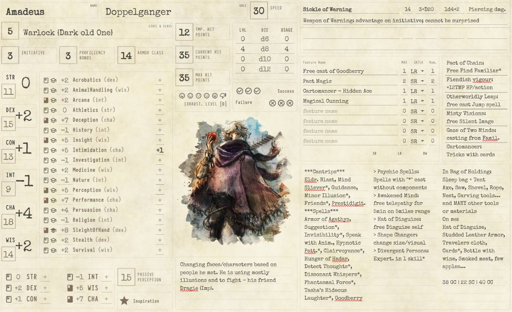

# DnD Character Sheet

## Live Demo

[Open the DnD Character Sheet demo](https://alfonsZelicko.github.io/dnd-character-sheet)

The demo is published automatically from `main` when `.github/workflows/deploy-demo.yml` completes successfully.

<div align="center">
  
</div>

Behold, traveler, and lend thine ear. This humble work is my personal endeavor, wherein I tinker with curious libraries of the React realm, most notably [Jotai](https://github.com/pmndrs/jotai) and [MUI](https://mui.com/). The creation takes the shape of a character scroll for the great game of DnD. All memories are kept within the browser’s own hidden vault, `localStorage`, so the demo may remain ever light and wholly static.

This journal has been carefully attuned for full-screen use upon a tablet, where it feels most at home. Should any soul desire it shaped for a different resolution or device, I would gladly reforge it.

## Features

- **Character Preview** presents character statistics, abilities, skills, saving throws, and notes. Notes support rich-text formatting such as bold and italics.
- **Inventory** keeps backpack items, quick-slot items, coins, and a separate list of weapons. Weapons can be added to or removed from the list.
- **Options** lets you export character data or a full backup, import JSON files, choose or reset app colors, set display preferences, and choose how many weapons appear on Character Preview (two by default).
- Character data and app preferences are stored locally in the browser. A full backup contains separate `character` and `options` sections; a character-only export omits `options`, and importing one leaves current app preferences in place.
- On first launch, visitors without saved character data can choose to load a sample character from `public/demo-character.json` or start with a blank sheet. Existing character data and app options are never replaced by the sample.

## Project Setup

- **Node Version**: 20.19+ or 22.12+
- **Package Manager**: pnpm 10.23.0
- **Build Tool**: Vite

### Getting Started

1. Install dependencies:
   ```bash
   pnpm install
   ```

2. Run the development server:
   ```bash
   pnpm dev
   ```

3. Build the app:
   ```bash
   pnpm build
   ```

The production build is written to `dist/`. For a Chrome extension, load that folder into Chrome as an unpacked extension.

### Tests

Run tests in watch mode while developing, or run them once for a CI-style check:

```bash
pnpm test
pnpm test:run
pnpm test:changed
```

`pnpm test` watches for edits and reruns related tests while the process stays open. `pnpm test:changed` uses Vitest's dependency cache to run tests affected since its previous run; its first run executes the full suite and records dependencies. This mode requires Node.js 22.15 or newer and does not require Git. Keep `pnpm test:run` for a complete run, such as before a release or in CI.

Component tests live next to their components. Broader tests that cover shared app behavior live in `tests/`.

## Development Rules: Persistent Data and Backups

Components persist their state in `localStorage` through Jotai `atomWithStorage`. The storage key is the durable identity of each value, so changing a key can otherwise make existing data appear to vanish.

- Keep character keys for data belonging to a character (for example `name`, `features`, or `backpack-atom`).
- Prefix new app preference keys with `options_` (for example `options_weapons-on-preview`). Existing preference keys are also recognized: `theme-colors`, `showIncDecButtons`, and `character-picture-mask`.
- If a persisted key is renamed, removed, or its stored value shape changes, update `src/features/characterData.ts`: increment `CHARACTER_DATA_SCHEMA_VERSION` and add a migration from the previous schema version in `migrations`. Migrations run one version at a time and are used for both local data and imported backups. Do not edit or delete old migrations; add the next step.
- If a new option key is introduced, add it to the `options_` namespace so exports keep it in the `options` section. If an existing option key does not use that prefix, add it to `optionKeys` in `characterData.ts`.
- Keep `appVersion` sourced from `package.json` through Vite's `__APP_VERSION__` define. Bump the package version for a release; compatibility migrations are driven by `CHARACTER_DATA_SCHEMA_VERSION`, not by the app version.
- Preserve import compatibility when changing the backup shape. `parseCharacterBackup` must continue to recognize old flat exports and schema v1 backups, and tests should cover each supported format plus the current character-only and full-backup formats.

## TODO / Roadmap

### Immediate Enhancements

- Implement **custom XML layout configuration** for greater flexibility in character sheet presentation.
- Expand core features:
  - Companion list management
  - Enhanced inventory handling
  - Detailed character traits and abilities, etc.

### Future Development Plans

- Explore **Electron port** to enable a desktop application experience.
- Develop a **Chrome extension** to synchronize character data across devices.
- Early experiments with **MCP server integration**: this may include connecting to 5e Tools or other rule servers for automated rule extraction.

If you’re interested in contributing to any of these efforts or testing features, I’d be glad to collaborate and help you get set up.
